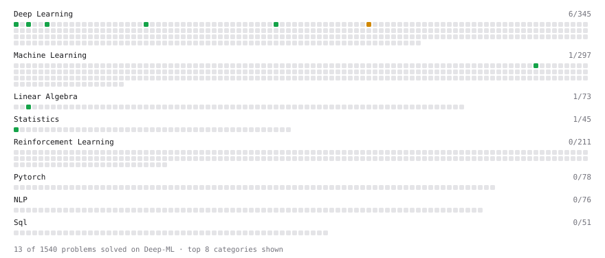

# Deep-ML

My machine learning practice from [Deep-ML](https://www.deep-ml.com). Every solution here was written by hand.

**14** solved · 14 problems · 0 labs · 0 math

[**Browse the interactive portfolio**](https://hanktseng131415go.github.io/deep-ml/) to replay this filling in over time.

## Problems

| | Difficulty | Solved | |
| --- | --- | --- | --- |
| [Calculate Covariance Matrix](https://www.deep-ml.com/problems/10) | easy | 2026-10-06 | [solution](problems/0010-calculate-covariance-matrix) |
| [Derivative of a Polynomial](https://www.deep-ml.com/problems/116) | easy | 2026-10-09 | [solution](problems/0116-derivative-of-a-polynomial) |
| [Derivatives of Activation Functions](https://www.deep-ml.com/problems/217) | easy | 2026-10-15 | [solution](problems/0217-derivatives-of-activation-functions) |
| [GeLU Activation Function ](https://www.deep-ml.com/problems/147) | easy | 2026-10-14 | [solution](problems/0147-gelu-activation-function) |
| [Gradient Direction and Magnitude](https://www.deep-ml.com/problems/308) | easy | 2026-10-11 | [solution](problems/0308-gradient-direction-and-magnitude) |
| [Implement the ELU Activation Function](https://www.deep-ml.com/problems/97) | easy | 2026-10-14 | [solution](problems/0097-implement-the-elu-activation-function) |
| [Implementation of Log Softmax Function](https://www.deep-ml.com/problems/39) | easy | 2026-10-14 | [solution](problems/0039-implementation-of-log-softmax-function) |
| [Reshape Matrix](https://www.deep-ml.com/problems/3) | easy | 2026-10-07 | [solution](problems/0003-reshape-matrix) |
| [Sigmoid Activation Function Understanding](https://www.deep-ml.com/problems/22) | easy | 2026-10-12 | [solution](problems/0022-sigmoid-activation-function-understanding) |
| [Single Neuron](https://www.deep-ml.com/problems/24) | easy | 2026-10-12 | [solution](problems/0024-single-neuron) |
| [Chain Rule for Composite Functions](https://www.deep-ml.com/problems/214) | medium | 2026-10-09 | [solution](problems/0214-chain-rule-for-composite-functions) |
| [Compute the Hessian Matrix](https://www.deep-ml.com/problems/218) | medium | 2026-10-11 | [solution](problems/0218-compute-the-hessian-matrix) |
| [Jacobian Matrix Calculation](https://www.deep-ml.com/problems/202) | medium | 2026-10-12 | [solution](problems/0202-jacobian-matrix-calculation) |
| [Partial Derivatives of Multivariable Functions](https://www.deep-ml.com/problems/215) | medium | 2026-10-09 | [solution](problems/0215-partial-derivatives-of-multivariable-functions) |

---

_This file is regenerated by Deep-ML on every push._
